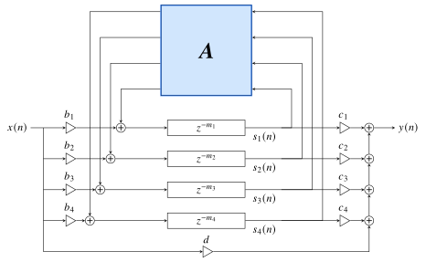
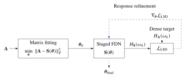
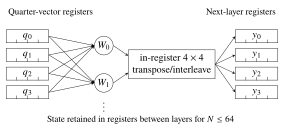

# Structured Pruning of Feedback Delay Networks

Code, data, and analysis for:

> F. Franchino and K. Prawda, **"Structured Pruning of Feedback Delay Networks,"**
> arXiv:2610.38768, 2026. Submitted to the IEEE Open Journal of Signal Processing.
> [paper](https://arxiv.org/abs/2610.38768) · [audio examples](https://cucuwritescode.github.io/demo-day/)

Start from a dense FDN that already sounds right. Its feedback matrix is
approximated by a product of fixed routing stages and small orthogonal blocks,
pairwise Givens rotations (b = 2) and radix-4 blocks (b = 4), and the fit is then
refined against the magnitude response of the complete reverberator. Every
intermediate is orthogonal by construction, so energy preservation is never at
risk, and the delays, gains, and attenuation keep the values of the original
design. Hand-written NEON kernels apply the stages one by one and never form the
dense product.

<p align="center"><picture><source media="(prefers-color-scheme: dark)" srcset="assets/fig_fdn_diagram_dark.svg"></picture></p>


### Results (Apple M2, FP32, feedback multiply)

<p align="center"><picture><source media="(prefers-color-scheme: dark)" srcset="assets/fig_table2_dark.svg"></picture></p>

Blocked times SGEMV back to back; isolated times one call at a time, which is what a per-sample callback pays. Full protocol in the paper (Sec. V, Table 2).
At N = 256 coefficient storage falls from 65,536 to 768 floats. In the listening
study (34 participants), the selected configurations scored 94–99 on a 0–100
similarity scale against their dense references.

The two-phase fit, matrix fitting then response refinement against the complete
reverberator,

<p align="center"><picture><source media="(prefers-color-scheme: dark)" srcset="assets/fig_pipeline_dark.svg"></picture></p>

and the register-resident radix-4 stage the C++ kernels implement for N <= 64,

<p align="center"><picture><source media="(prefers-color-scheme: dark)" srcset="assets/fig_kernel_dark.svg"></picture></p>

## Layout

```
staged-fdn-pruning/
  staged_fdn/            projection, refinement, export (python)
    projection.py        pairwise (b=2): alternating atan2 sweeps + L-BFGS + LSD refinement
    radix4.py            radix-4 (b=4): per-block Procrustes (SVD) + Cayley refinement
    export.py            export of repeated-perfect-shuffle fits to the C++ kernel convention
  cpp/
    staged_fdn.h         pairwise NEON kernel
    radix4_fdn.h         radix-4 NEON kernels (register-resident for N <= 64)
    test_radix4.cpp      14 configurations x 32 seeded vectors vs a double-accumulation reference
    benchmark.cpp        per-size benchmark harness (blocked timing, memory clobber)
    roofline/            block-size comparison, peak probe, final benchmark table
                         (frozen_run_2026-08-22.txt is the run reported in the paper)
  data/                  trained dense source systems (N = 4 ... 256): matrices, delays, gains
  experiments/           projection + listening-render scripts for the paper's configurations
  listening_analysis/    anonymised listening-study scores and analysis
```

## Quickstart

Python (projection and refinement):

```bash
cd staged-fdn-pruning
pip install -e .
python experiments/experiment_radix4_N32.py     # reproduces the paper's N=32 fits
```

C++ (kernels, tests, benchmarks; Apple Silicon):

```bash
cd staged-fdn-pruning/cpp
clang++ -O3 -std=c++17 test_radix4.cpp -o test_radix4 && ./test_radix4
clang++ -O3 -std=c++17 -framework Accelerate benchmark.cpp -o benchmark && ./benchmark
```

Benchmark numbers are sensitive to machine load; `roofline/final_table.cpp` gates on
a performance-core canary and prints throughput-to-latency bounds.

## Citation

```bibtex
@misc{franchino2026structured,
  title         = {Structured Pruning of Feedback Delay Networks},
  author        = {Facundo Franchino and Karolina Prawda},
  year          = {2026},
  eprint        = {2610.38768},
  archivePrefix = {arXiv},
  primaryClass  = {eess.AS},
  note          = {Submitted to the IEEE Open Journal of Signal Processing}
}
```

See `LICENSE` for terms.
